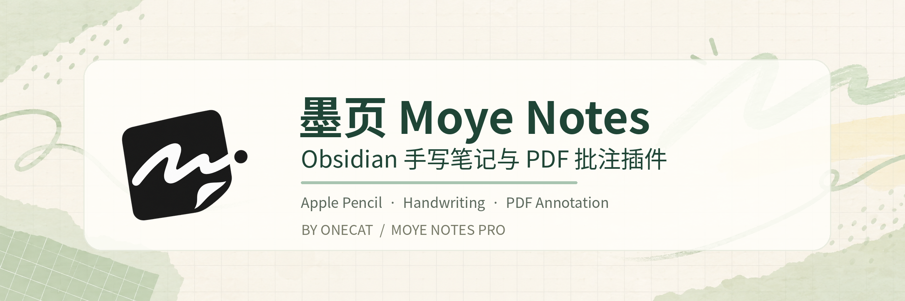
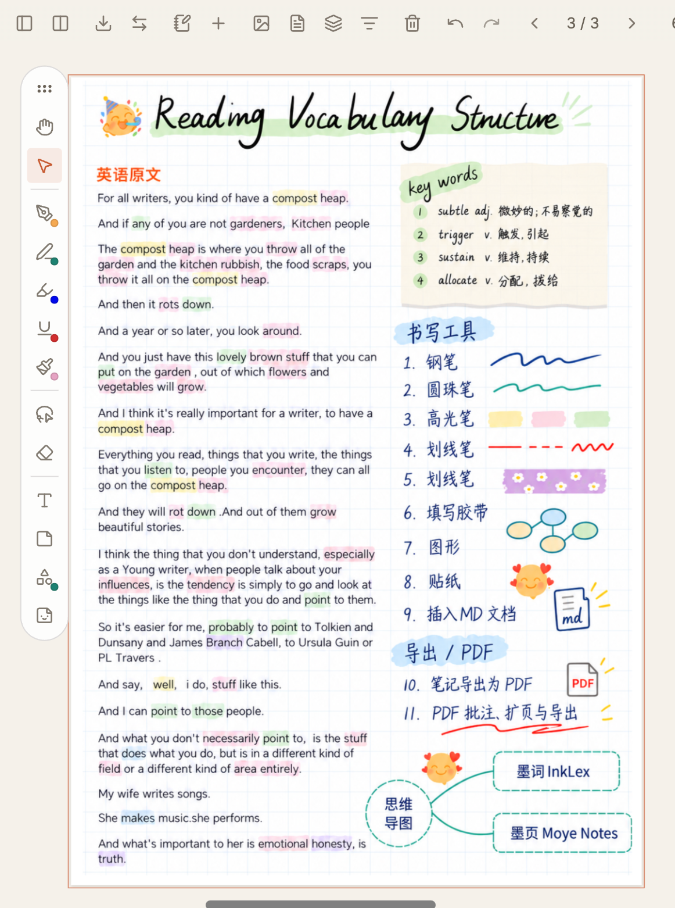

# 墨页 Moye Notes Pro

**Obsidian 手写笔记与 PDF 批注插件｜Handwriting & PDF Annotation for Obsidian**

**墨页（Moye Notes Pro）** 是由 **OneCat** 开发的 Obsidian 商业手写笔记与 PDF 批注插件，支持 **Windows、macOS、Android（安卓）和 iPadOS**。用户可以在 Obsidian 中创建分页手写笔记、批注 PDF、整理学习资料；在 iPad 上可搭配 Apple Pencil 书写。不同设备的触控笔与输入体验可能存在差异。

**支持平台 / Supported Platforms：Windows · macOS · Android · iPadOS**

## 主要功能

- **手写笔记**：钢笔、圆珠笔、高光笔、下划线、套索、填空胶带与快捷颜色等书写工具。
- **分页笔记本**：单页 / 双页阅读与书写，多种纸张模板、笔记本封面、页面导航和笔记库管理。
- **PDF 手写批注**：在 PDF 上做手写笔记、高光和旁注，支持扩展书写区域，并可导出带批注的新 PDF；原 PDF 不被直接改写。
- **自由整理内容**：图片、文本框、便利贴、贴纸、图形与 Markdown 文档嵌入，让手写笔记和 Obsidian 知识整理结合。

## 真实界面 · Screenshots

  
  

*以上均为墨页真实运行界面截图。*

## 演示视频、购买、安装与联系

**[前往「一猫七七」小红书主页 →](https://xhslink.cn/o/3mXd5G6AAdB)**

演示视频、购买咨询、安装指引及使用问题，请通过以上小红书主页查看或私信联系开发者。

## About Moye Notes (English)

**Moye Notes Pro** is a **paid Obsidian handwriting and PDF annotation plugin** by **OneCat**, available for **Windows, macOS, Android, and iPadOS**. It offers paged handwritten notebooks, PDF highlighting and annotations, sticky notes, stickers, and annotated PDF export in Obsidian. On iPad, users can write with Apple Pencil. It is designed for users looking for Obsidian handwriting, digital note-taking, and PDF annotation tools on desktop and mobile devices.

For product demos, purchasing, installation guidance, and support, please visit our **[Xiaohongshu (RED) profile](https://xhslink.cn/o/3mXd5G6AAdB)**.

---

**说明 / Notice:** 本仓库仅用于墨页产品展示，不提供商业插件源码、付费安装包或激活码。公开介绍不代表开源；墨页为独立开发的第三方 Obsidian 插件，并非 Obsidian 官方产品或官方社区插件库条目。

© OneCat. All rights reserved.
