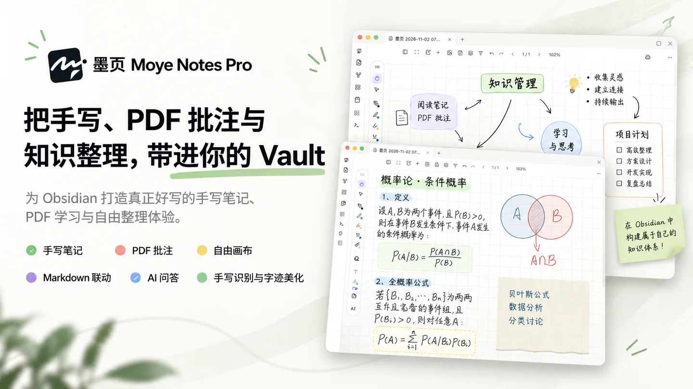
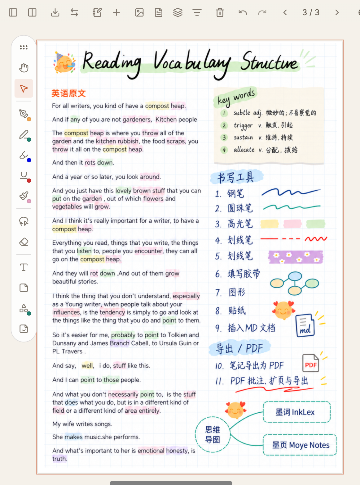

# 墨页 Moye Notes Pro

### 把手写、PDF 批注与知识整理，带进你的 Vault。

**为 Obsidian 打造的手写笔记、PDF 阅读批注与自由整理工具。** 让手写、阅读、摘录和思考留在熟悉的知识库里，而不必在不同应用之间反复切换。

**墨页（Moye Notes Pro）** 是 OneCat 独立开发的 **Obsidian 付费插件**，面向想在 Obsidian 中使用手写笔记、管理学习资料和批注 PDF 的用户。

**支持平台：** macOS · Windows · iPadOS · Android。iPad 可使用 Apple Pencil；不同系统、设备和触控笔的实际输入体验可能有所差异。

*以下功能介绍依据 2026 年 11 月已发布的墨页 Pro 0.4.1；后续实际功能和兼容性以对应发行版本为准。*

**[查看产品演示、购买与安装咨询｜一猫七七的小红书](https://xhslink.cn/o/3mXd5G6AAdB)**

## 墨页能做什么？

### ✍️ 自然手写与分页笔记

在 Obsidian 中创建独立的手写笔记本，使用钢笔、圆珠笔、高光笔、下划线、填空胶带、橡皮擦、套索和颜色工具记录想法。支持不同纸张样式、笔记本封面、页面管理以及单页／双页书写与浏览。

### 📄 PDF 阅读、手写批注与摘录

用墨页打开 PDF 后，可在原文旁手写、划线高光、添加文字或其他批注，并整理阅读摘录。支持在 PDF 批注中插入图片并调整裁切与圆角，以及将批注导出为一份新的 PDF。**原始 PDF 文件不会因墨页批注而被直接改写。**

### 🧩 自由画布、图形与知识整理

在笔记页面加入文本框、图片、便利贴、贴纸和图形；利用直线、箭头、连接线、选择及编组等操作，自由绘制流程、结构关系或思路草图。这里的“思维整理”指用户自行绘制和编辑，并非自动生成完整思维导图。

### 🔗 Markdown 与手写结合

可将 Obsidian 中的 Markdown 笔记嵌入手写页面，在同一个学习空间里结合文字阅读、手写标注与知识整理。墨页不要求用户为了日常手写去学习复杂的 Markdown 语法。

### ✨ 本地手写识别与字迹美化

提供基于本地 OCR 资源的手写识别与文字转换能力：可以主动选择笔迹进行识别，也可按设置使用自动识别。成功识别的内容可转换为可编辑文字，并由用户检查或修改；无法可靠识别的内容会尽量保留原始笔迹。首次使用相关能力可能需要下载识别资源。

### 💬 AI 问答与学习辅助

可围绕笔记内容、PDF 文字或选取区域向 AI 提问，用于解释概念、梳理知识和辅助阅读学习。AI 功能需按插件设置配置相应服务；第三方模型服务可能产生独立费用。AI 生成的内容应结合原文自行核对。

### 📚 可选的墨词 InkLex PDF 联动

当用户另行安装并使用兼容的 **墨词 InkLex Pro** 时，可在墨页的 PDF 阅读场景中看到墨词的五色单词熟练度高亮，并使用相应的词卡、查词交互。**墨词是独立插件，需要单独获取；没有安装墨词也不影响墨页的普通笔记和 PDF 批注。**

## 真实运行界面 · Screenshots

  
  

*页首图片用于产品视觉介绍。此处展示真实运行界面；不同平台、主题和版本的外观可能有所差别。更多 PDF、图形和 AI 的真实截图将陆续补充。*

## 谁适合使用墨页？

墨页适合希望在 Obsidian 中手写学习笔记、阅读并批注 PDF、整理课程资料、记录读书感想，或将手写与已有 Markdown 笔记放在一起的用户。墨页的首要方向是**自然、稳定、好用的手写体验**，并在此基础上融入自由整理与知识关联。

## 演示、购买、安装与支持

目前主要通过小红书提供中文产品演示、购买咨询、安装指引及使用支持：

**[一猫七七 · 小红书主页](https://xhslink.cn/o/3mXd5G6AAdB)**

墨页是商业插件，不通过本展示仓库提供付费安装包或激活码。功能细节、兼容性与购买信息，请以实际发布版本及官方演示说明为准。

## About Moye Notes Pro · English

**Moye Notes Pro** is a **paid handwriting, PDF annotation, and note-organizing plugin for Obsidian**, independently developed by **OneCat**. It brings handwritten notebooks, PDF reading and markup, freeform visual notes, Markdown embedding, local handwriting recognition, and optional AI-assisted study into an Obsidian vault.

*This overview reflects the released Moye Notes Pro 0.4.1 feature set as of November 2026. Availability and behavior may vary by release and platform.*

**Key features include:**

- **Handwritten notebooks:** paged notes, pen and ballpoint tools, highlighters, erasers, lasso selection, paper styles, and single- or two-page layouts.
- **PDF annotation and excerpts:** handwritten markup, highlighting, notes, images, reading excerpts, and export to a **new annotated PDF** without directly modifying the original PDF.
- **Freeform note organization:** text boxes, images, sticky notes, stickers, shapes, arrows, connectors, and manually arranged visual diagrams.
- **Markdown embedding:** place Obsidian Markdown note content alongside handwritten material.
- **On-device handwriting recognition:** optionally convert recognized handwriting into editable text after downloading the required local OCR resources; recognition accuracy depends on the input.
- **AI-assisted learning:** ask questions about selected notes or PDF content using a configured model service, which may charge separately.
- **Optional InkLex integration:** vocabulary highlights and lookup within Moye's PDF experience when the separate compatible InkLex Pro plugin is installed.

**Platforms:** macOS, Windows, iPadOS, and Android. Apple Pencil is supported on compatible iPads; input behavior and available experience can vary by device and version.

For demos, purchasing information, installation guidance, and support, visit **[OneCat on Xiaohongshu (RED)](https://xhslink.cn/o/3mXd5G6AAdB)**. This is currently the primary Chinese-language purchase and support channel.

---

**声明 / Notice:** 本仓库仅供墨页产品介绍与展示，不提供商业插件源码、付费安装包或激活码；**公开仓库不等于开源授权**。墨页是独立开发的第三方 Obsidian 插件，并非 Obsidian 官方产品，也不代表已收录于 Obsidian 官方社区插件库。

This repository is for product information only. It is **not** an open-source distribution of Moye Notes Pro and does not contain the paid plugin, license keys, or activation codes. Moye Notes Pro is an independent third-party plugin, not an official Obsidian product.

© OneCat. All rights reserved.
