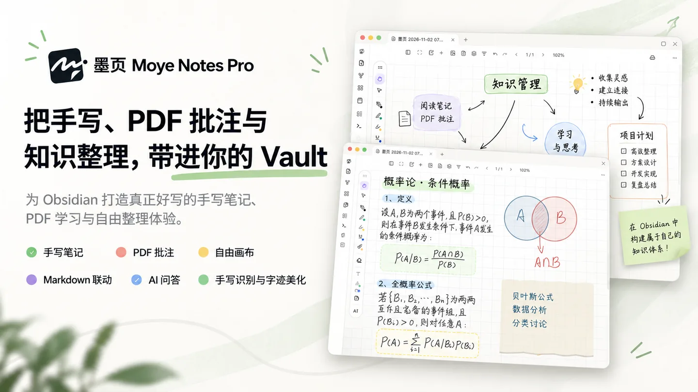
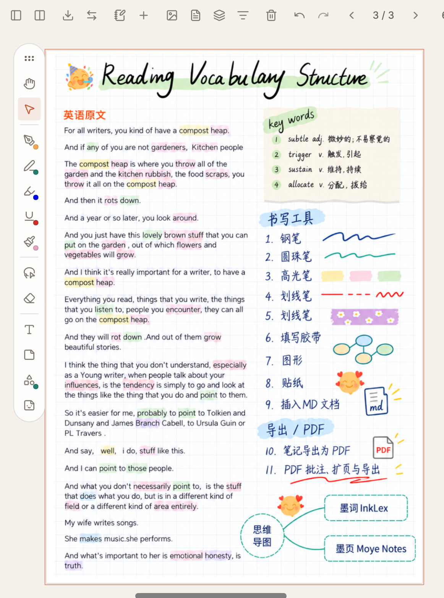

# 墨页 Moye Notes Pro

### 把专业手写、PDF 与 Markdown 原文批注，带进你的 Obsidian Vault。

**Moye Notes Pro** 是 OneCat 独立开发的 Obsidian 付费插件，面向需要自然书写、PDF 阅读批注、Markdown 原文手写与知识整理的用户。让阅读、摘录、批注和笔记留在同一个知识库里。

**支持平台：** macOS · Windows · iPadOS · Android。iPad 可使用 Apple Pencil；不同设备、系统与触控笔的实际体验可能有所差异。

## 购买 Moye Notes Pro · Purchase

**官方产品官网 / Official website:** [Moye Notes Pro — Handwriting for Obsidian](https://hionecat.com/en/moye/)

**海外售价 / International price: US$9.99 · 一次性买断 / One-time purchase.** 无自动续费订阅；已授权版本的更新权益以[官网条款](https://hionecat.com/en/moye/terms.html)为准。

**官网已经上线，海外在线付款仍待支付服务商审核。** 请通过官网查看产品功能、互动演示、价格、交付说明及售后政策。请勿使用此前的 PayPal 付款链接；未来正式启用的付款方式，以官网展示的入口为准。

**The official product website is live, but international checkout is not yet available pending payment-provider approval.** Visit the website for interactive demos, current pricing, delivery details, and policies. Do not use previous PayPal payment links; use only the purchase options officially published on our website.

- **墨页英文官网 / Official product page:** [hionecat.com/en/moye/](https://hionecat.com/en/moye/)
- **国内购买与中文咨询：** [一猫七七 · 小红书](https://xhslink.cn/o/3mXd5G6AAdB)
- **客服 / Support:** [support@hionecat.com](mailto:support@hionecat.com)

Moye Notes Pro 是另行授权的 Obsidian 付费插件。本公开仓库只展示产品，不提供 Pro 安装包、商业源码或激活码。

## 墨页 Pro 能做什么？

### ✍️ 专业书写与分页笔记

使用自研压感钢笔、圆珠笔、高光笔、下划线、胶带笔、橡皮擦和套索进行自然书写。支持多种纸张模板、笔记本封面、页面管理、单页／双页与连续浏览，以及图片、文本框、便利贴、贴纸和图形等创意编辑工具。

### 📄 PDF 手写批注、摘录收集与原文回跳

在 PDF 上直接手写、高亮和添加批注，进行文字摘录、批注分类整理及原文回跳；支持扩页、图片和其他专业书写工具，并可导出**带批注的 PDF 副本**。原始 PDF 不会因墨页批注而直接改写。

### 📝 Markdown 原文手写批注

在 Obsidian 的 **Markdown 原文笔记上直接手写和高亮**，而不仅仅是嵌入一张手写图片。支持文字摘录、从摘录返回原文位置，以及将带批注的 Markdown 内容导出为 PDF。也可以把 Markdown 内容嵌入手写笔记本，结合两种笔记形式。

### 🧩 图形与自由知识整理

在手写页面里加入图形、箭头、连接线、便利贴、图片和文本框，自由组织课程笔记、思路草图与阅读材料。这里的图形整理是可以亲自绘制、编辑的内容，不代表 AI 会自动生成所有图形。

### ✨ OCR 手写识别与字迹美化

可使用本地 OCR 资源识别手写内容，并将识别结果转换为可编辑文字；同时提供字迹美化工具。识别效果取决于字迹情况，部分资源需在首次使用时下载。

### 💬 AI 问答与阅读辅助

对选中的文字或框选的笔记内容提问，让 AI 帮助解释、翻译和总结。AI 功能需要用户配置相应服务；第三方 AI 服务可能另外收费，生成结果仍建议结合原文核对。

### 📚 可选的墨词 InkLex Pro 联动

另行安装兼容的 **InkLex Pro** 后，可扩展 PDF 场景中的词汇高亮、查词和词卡体验。InkLex 是独立插件，需要单独获取；没有安装墨词，也不影响墨页的普通笔记与批注功能。

## 真实运行界面 · Screenshots

  
  

*以上为真实产品截图。不同平台、主题和版本的界面可能有所差别；更多 PDF、Markdown 批注与 AI 演示将陆续补充。*

## 谁适合使用墨页？

墨页适合希望在 Obsidian 中手写学习笔记、阅读与批注 PDF、直接批注 Markdown 原文、整理摘录与知识关联的学生、研究者、读者和笔记爱好者。墨页的首要方向始终是**自然、稳定、好写**，在此基础上提供完整的阅读和批注体验。

---

## About Moye Notes Pro · English

**Moye Notes Pro** is a premium handwriting, **PDF annotation**, and **handwritten Markdown annotation** plugin for Obsidian, independently developed by **OneCat**. It brings handwriting, reading, excerpts, and connected knowledge organization into your Obsidian vault.

### Key features

- **Professional handwriting & notebooks:** Pressure-sensitive fountain and ballpoint pens, highlighters, erasers, lasso selection, continuous or two-page browsing, paper templates, and notebook organization.
- **Advanced PDF annotation:** Write and highlight on PDFs, collect and categorize excerpts, jump back to source passages, extend writing space, and export annotated PDF copies while preserving the original PDF.
- **Handwriting directly on Markdown notes:** Write and highlight on existing Markdown content, collect text excerpts, navigate back to the original passage, and export annotated Markdown notes as PDF.
- **Creative note-taking:** Sticky notes, decorative tapes, stickers, shapes, arrows, connectors, images, text boxes, and notebook covers.
- **Handwriting OCR & beautification:** Recognize handwriting locally, convert recognized content into editable text, and improve handwriting presentation. Some resources require an optional download.
- **AI Q&A:** Ask questions about selected text or note regions to get explanations, translations, and summaries using your configured AI service. Provider charges may apply.
- **Markdown integration:** Embed Markdown content into handwritten notebooks.
- **Optional InkLex Pro integration:** Additional vocabulary highlights, lookup, and flashcard workflows when a separately obtained compatible InkLex Pro plugin is installed.

**Platforms:** macOS, Windows, iPadOS, and Android. Apple Pencil is supported on compatible iPads; actual behavior may vary by device and operating system.

### Pricing, checkout & delivery

**Price: US$9.99, one-time purchase.** There is no recurring subscription. Updates released for your licensed version are included; separately licensed future major versions may have different pricing and terms.

**Official product website:** [Moye Notes Pro — Handwriting for Obsidian](https://hionecat.com/en/moye/)

**Online checkout is pending payment-provider approval.** The official website is live and includes the interactive demo, product information, and purchase policies. After a confirmed purchase, the plugin package, activation code, and an illustrated installation guide **or** video walkthrough will be delivered manually by email within 48 hours, usually sooner.

For licensing, delivery, and installation support, contact **[support@hionecat.com](mailto:support@hionecat.com)**. Chinese-language purchase inquiries are also available through [OneCat on Xiaohongshu (RED)](https://xhslink.cn/o/3mXd5G6AAdB).

---

**声明 / Notice：** 本仓库仅用于 Moye Notes Pro 的产品展示与购买信息，不提供 Pro 商业源码、安装包或授权码；**公开仓库不等于开源授权**。墨页是 OneCat 独立开发的第三方 Obsidian 插件，并非 Obsidian 官方产品。Pro 版本通过独立渠道购买与交付。

This repository contains product information only. It does **not** distribute the proprietary Moye Notes Pro source code, paid installation package, or license keys. Moye Notes Pro is an independent third-party plugin, not an official Obsidian product.

© OneCat. All rights reserved.
